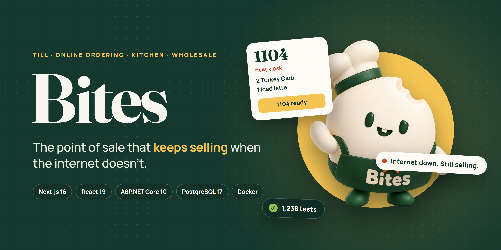
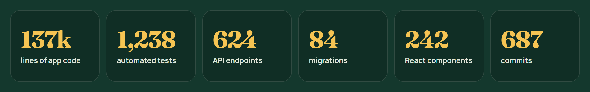
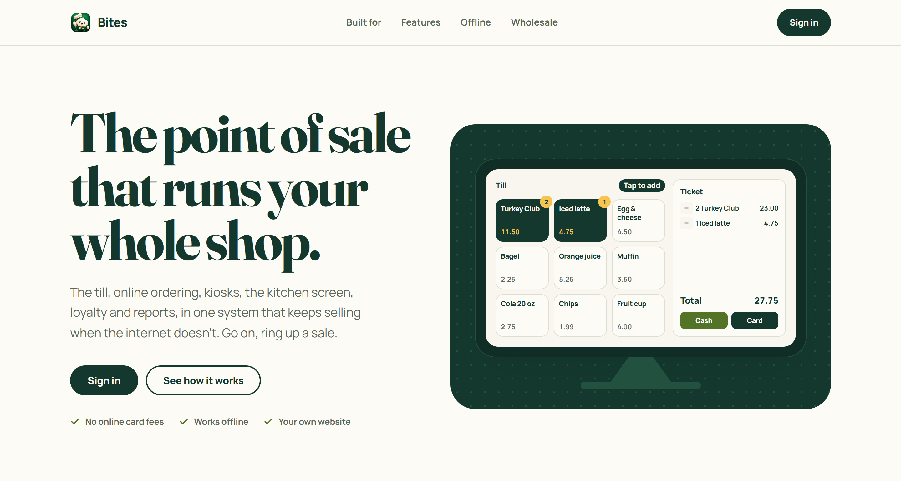
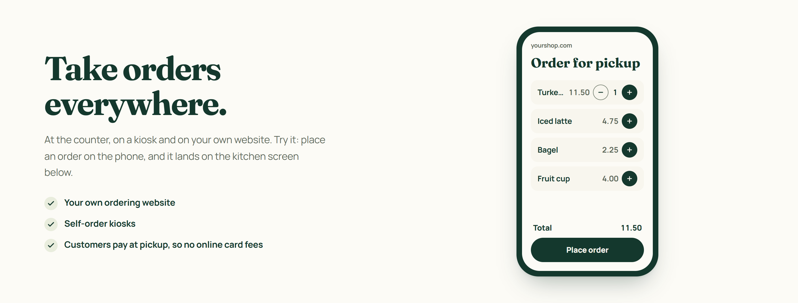
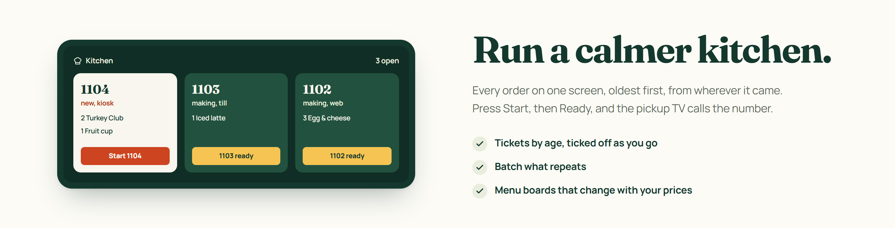
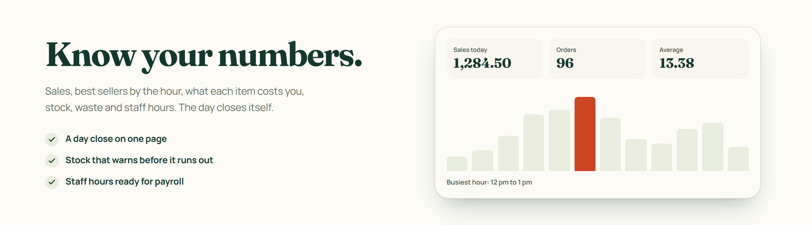
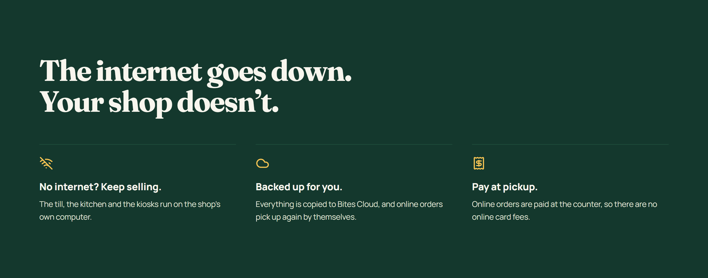
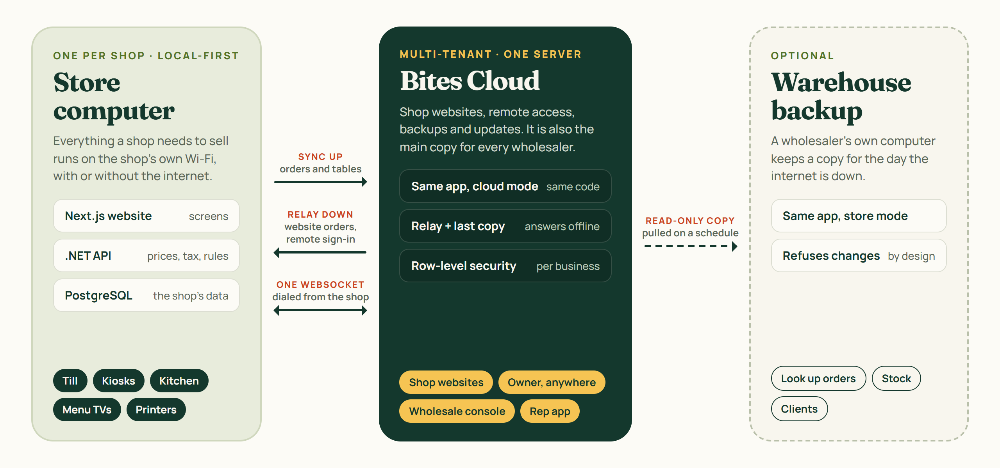

  

  <a href="https://bites-cloud.com"><b>See it live: bites-cloud.com</b></a>
  &nbsp;·&nbsp;
  <a href="#seven-problems-worth-reading-about">Engineering notes</a>
  &nbsp;·&nbsp;
  <a href="#about-the-source">Source is private</a>

# Bites

Bites is one system for a small food business: the till, online ordering on the shop's own website, self-order
kiosks, the kitchen screen, menu TVs, stock, costs, loyalty and reports. A second side serves the wholesalers who
supply those shops. Each shop runs on a computer in the shop, so a dropped internet connection doesn't stop a sale,
and a cloud adds the website, remote access, backups and updates.

I designed and built it end to end. This repository is the case study: what it does, how it is put together, and
the problems that were worth solving properly. The source code itself is private.

  

## What it does

| For | They get |
|---|---|
| **A shop** (deli, café, bakery, market) | A website with online ordering, kiosks, the till, a kitchen screen, menu TVs and a pickup board, stock and waste, food costs, a loyalty club, house accounts, staff hours, a day close and reports |
| **A wholesaler** | A console with orders, a catalog, buying, clients and credit, a counter till, a rep app for visits, and a public catalog shops order from |
| **The platform operator** | One console for every business: health, feature switches per business, store computers and their updates, a read-only SQL tool fenced to one business at a time |

Seven roles sign in (owner, cashier, kitchen, kiosk, TV screen, sales rep, platform admin), and every screen is
built for the device it lives on: a till that works with wet hands, a kiosk shared by strangers, a TV nobody touches.

## See it

The front page of [bites-cloud.com](https://bites-cloud.com) is made of working demos, not pictures: ring up a sale
on the till, place an order on the phone and watch the ticket land on the kitchen screen.

## How it is put together

One codebase runs in two modes. In a shop it is the **store computer**: database, API and website on the shop's own
Wi-Fi. On a server it is **Bites Cloud**: many businesses on one database, each fenced from the others. The two talk
over a single WebSocket that the shop dials, so a shop needs no static address and no open port.

| Layer | Built with |
|---|---|
| Screens | Next.js 16 (App Router), React 19 with the React Compiler, Redux Toolkit + RTK Query, Tailwind CSS 4, Framer Motion |
| API | ASP.NET Core 10 minimal APIs, EF Core, cookie sessions with PBKDF2, a CSRF guard, rate limiting |
| Data | PostgreSQL 17: 78 tables, 84 migrations, jsonb for settings, row-level security, advisory locks |
| Tests | xUnit + Testcontainers (a real Postgres per test class), Vitest + Testing Library, axe, Playwright |
| Shipping | Docker Compose, Caddy, Cloudflare; a self-contained Windows package for store computers that updates itself and rolls back |

A few rules hold everywhere:

- **The server decides.** A screen sends ids, choices and quantities. Prices, tax, availability and loyalty are
  worked out on the server from the menu it holds, so a tampered request cannot change a price.
- **Every change has a name.** Each write records who made it.
- **One business never sees another.** Four separate fences, and a test that fails when a new table forgets one.

## Seven problems worth reading about

| | Problem | The short version |
|---|---|---|
| 1 | [A shop that keeps selling offline](docs/01-local-first.md) | Local-first shops, a cloud that relays website orders into the shop, and what each side does when the line drops |
| 2 | [Four fences between businesses](docs/02-multi-tenancy.md) | Tenant resolution, query filters, a save guard and Postgres row-level security, kept honest by one test |
| 3 | [Two taps in the same instant](docs/03-two-taps-at-once.md) | One order paid at two tills is paid once; the last one on the shelf goes to one customer |
| 4 | [Shipping to computers I can't reach](docs/04-shipping-to-shops.md) | A release that rehearses the real update on brand-new databases, and an updater that rolls itself back |
| 5 | [Testing money](docs/05-testing-money.md) | A shop's whole day in a real browser, every amount worked out in whole cents |
| 6 | [161 accessibility checks](docs/06-accessibility.md) | An audit, fixes that land once and apply everywhere, and a test that keeps contrast at 4.5:1 |
| 7 | [Screens that perform together](docs/07-screens-that-perform.md) | Two kiosks play one scene by sharing a clock and a single fact |

## The quality bar

- **1,238 automated tests**: 498 against the API on a real PostgreSQL, 740 for the front end. Test names are
  sentences, such as `The_database_refuses_to_save_another_businesses_rows`.
- **The money paths run in a real browser** before every release: a cash sale, a website order paid at the till, a
  split payment, a refund, a void and the day close, with every expected amount computed in the test.
- **A release rehearses itself.** It installs the package a shop will download, starts it on new databases several
  times, performs the update and a deliberate failed update, and refuses to ship if any step fails.
- **A lunch rush on demand.** A load test plays website customers, kiosks, tills and the kitchen at once, then checks
  the cases that only break when two things happen in the same instant.
- **Four manuals** (owner, wholesale, platform admin, developer) are kept in step with the product.

## How it was built

Bites is a solo project: 687 commits in its first seven weeks. I built it with an AI coding agent (Claude Code) as a
pair programmer. I own the product decisions, check every screen by hand and run every release myself. What makes
that pace safe is the system around the work: a written guide the agent reads at the start of every session, one
commit per feature, tests for what each change touches, the rehearsal before a release, and a list of past mistakes
that is kept so they are not made twice.

## About the source

The code is private because Bites is a product in use, not a demo. If you are reviewing my work for a role, I am glad
to walk through any part of it or give read access to the repository. The notes above include short excerpts where
the code says it better than a description.

---

  Built by <b>Ammar Algaithy</b> · <a href="https://bites-cloud.com">bites-cloud.com</a> 
  © 2026 Ammar Algaithy. Text and images describe a private codebase; all rights reserved.

