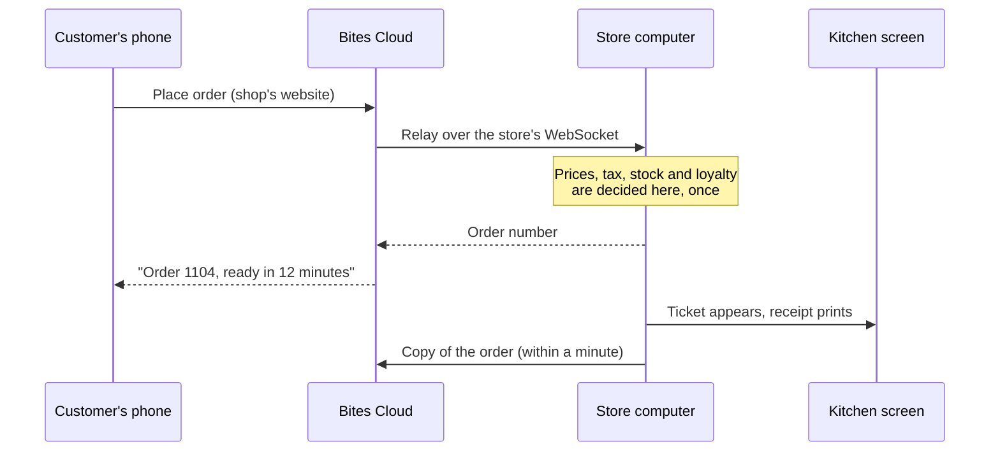

# 1. A shop that keeps selling offline

[← Back to the overview](../README.md)

## The problem

A deli takes most of its money in two hours around lunch. A point of sale that lives in the cloud stops the moment
the internet does, and a small shop's internet is the least reliable thing in the building. The till, the kitchen
screen, the kiosks and the receipt printers have to keep working with the cable unplugged.

The shop also wants what only a server can give: a website that takes orders, the owner looking at today's sales
from home, backups, and updates that install themselves.

## The decision: local-first shops, one codebase in two modes

Every shop has one **store computer**. It runs PostgreSQL, the API and the website, and every device in the shop
talks to it over the shop's own Wi-Fi. Nothing a shop needs in order to sell leaves the building.

**Bites Cloud** runs the same application with one setting changed (`Bites:Mode = cloud`). There is no second
codebase to keep in step: the mode switches a handful of behaviours, such as which middleware is in the pipeline and
whether a request is answered here or passed on.

## The line between them

The store computer dials the cloud and keeps one WebSocket open. The shop is always the one that calls, so it needs
no static address, no port forwarding and no changes to its router.

- **Linking** uses a code the owner reads from the cloud: hashed, valid for 30 minutes, usable once. The store gets a
  key back; the cloud keeps only the key's hash. A new link revokes the old one.
- **Staying up**: a hello and a ping every 30 seconds, and reconnection that backs off from 2 to 30 seconds.
- **One session per business** on the cloud, tied to the link, so a revoked store cannot keep talking.

## What travels, and which way

**Up, from shop to cloud.** Orders that changed since the last send go up every minute. Every other table of the
business goes up as one JSON document per table every hour, or at once when someone presses "Sync now"; tables that
have not changed since the last send are skipped. Sessions and print jobs never leave the shop.

**Down, from cloud to shop.** The cloud does not take a website order itself. It relays the request through the line
and the store computer answers through its own API, exactly as if the customer stood at a kiosk. There is one place
where a price is decided, so the website can never disagree with the till.

**Remote control.** When the owner signs in on the cloud from a phone, requests for the owner's, the till's and the
staff's pages are relayed to the store the same way.

## When the line is down

This is the part that had to be designed rather than hoped for.

| Who | What happens |
|---|---|
| The shop | Nothing changes. Till, kiosks, kitchen and printers never needed the internet. |
| A website visitor | The menu still shows, served from the cloud's last copy and marked as such. Placing an order is refused with a plain message, because a kitchen that cannot see the order must not be promised to the customer. |
| The owner, remotely | Reports and lists answer from the last copy. Changes are refused with a clear reason rather than queued and applied later behind the shop's back. |
| New staff accounts | Made once, on either side. Username, role and password hash (never the password) are copied over the line and queued while the store is offline. |

## Wholesalers are the other way round

A wholesaler's staff, drivers and reps are rarely in one building, so for them the cloud is the main copy. A
warehouse computer is optional and only a backup: it pulls a read-only copy and a middleware refuses every change, so
there is never a second place where an order could be edited.

## How it is tested

The cloud tests start a cloud and a store, each on its own PostgreSQL container, and join them with an in-memory
transport behind the same interface the WebSocket uses. A test can link them, place a website order, cut the line and
check what each side answers.

## What I would tell another engineer

- Decide which side is the truth for each kind of data and never let it be both. Most of the hard bugs in sync
  systems come from two places accepting the same change.
- Refuse clearly rather than queue silently. An owner who is told "the shop is offline, try again when it's back"
  trusts the system more than one whose change appears an hour later.
- Let the weaker network make the call. An outbound connection from the shop removed a whole class of setup problems.
