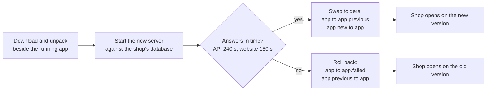

# 4. Shipping to computers I can't reach

[← Back to the overview](../README.md)

## The problem

Deploying to a server is easy to undo: watch the logs, roll back the image. A store computer is different. It sits
under a counter in a shop, nobody there is technical, and it updates itself at night. If a release does not start,
the shop opens in the morning with no till.

So a release has two jobs: ship to the cloud, and ship a package that every store computer will install unattended
and survive.

## What a shop installs

The owner downloads one small setup file from their page on the cloud. It carries the cloud's address and a code that
is good for 24 hours. Run once, it:

1. installs PostgreSQL and Node, and creates the database with random passwords kept in a file only administrators
   can read;
2. downloads the **store package**: the API as a self-contained Windows program (no .NET to install) and the website
   as a standalone Node server;
3. registers both to start with the computer and restart on failure, and opens the one port the shop's devices use;
4. links itself to the cloud with the code and pulls the business down: accounts, menu, settings and order history.

A new shop is selling on its own computer a few minutes after the download.

## How a shop updates, and how it backs out

Store computers ask the cloud for the current version each night, or when the platform console says "Update".



The shop's settings are kept across the swap, and the previous version stays on disk. A failed update costs the shop
nothing.

## The rehearsal

Unit tests and the development server exercise the code. They do not exercise *the package*: the self-contained
build, the files that were or were not copied in, the migrations running on a database that has never existed
before, the updater script itself. Each of those has failed at least once in a way nothing else caught. One crash
existed only in the self-contained build and was invisible everywhere except a real start of the real package.

So before a release ships, it is rehearsed on the developer's machine, touching nothing of the development stack:

- A tiny HTTP server **plays the cloud** and hands out the package that was just built.
- A scratch folder is laid out like a shop's, with a made-up previous version installed and a throwaway PostgreSQL.
- The **real updater** downloads and unpacks the package.
- The new server is started on **brand-new databases, several times**, migrations included. It must answer within the
  same limits a shop's updater allows.
- The updater performs its **real folder swap**.
- A deliberately **broken version is planted** to watch the rollback happen.

The release command runs this itself and refuses to continue when any step fails. There is a second level for the
installer end to end inside a clean virtual machine.

The promise is deliberately modest, and written at the top of the script: a release that passed can still fail in a
shop, but not for the reasons that have bitten before.

## One command

```
npm run release
```

1. Builds the store package.
2. Rehearses it.
3. Archives the committed code. Only what is committed ships; a half-finished change on disk cannot leak out.
4. Copies both to the server, rebuilds the API and website images, restarts them and publishes the new store package.
5. Checks that the site answers and prints the version the cloud now hands out.

Migrations run when the API starts, on the cloud and on each store computer. Data never ships: every computer keeps
and syncs its own.

## Staying honest between cloud and shops

Right after a release the cloud is ahead of the shops until they update. A new page on the cloud that relays to an
older store gets an answer the store does not know yet. The platform console shows each store's version, and
"is the store behind?" is the first question asked before anything is called a bug.

## What I would tell another engineer

Test the thing you ship, not the thing you built it from. The rehearsal is a few hundred lines of script and takes a
few minutes, and it is the only check in the project that has never given a false sense of safety.
