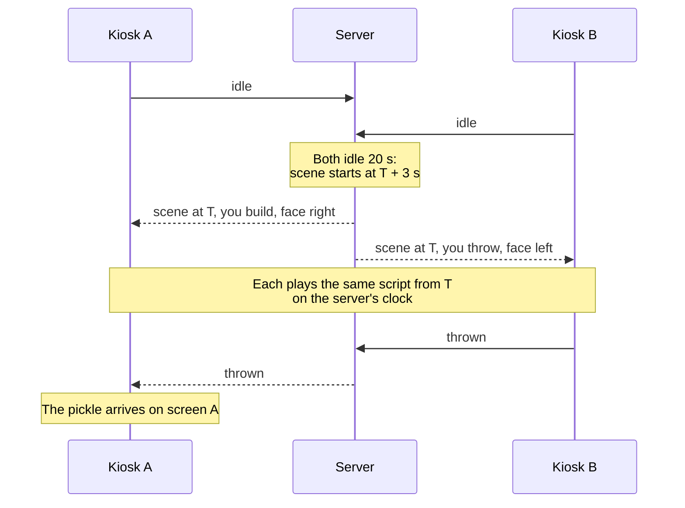

# 7. Screens that perform together

[← Back to the overview](../README.md)

## The problem

A shop's screens spend most of the day waiting: a kiosk nobody is using, a menu TV between glances. Bites has a
mascot, and the idea was that idle screens should feel alive, and alive *together*. Two kiosks side by side that
each play their own loop look like two adverts. Two kiosks where a pickle is thrown off the edge of one screen
and caught on the other look like one shop.

The engineering question is how two browsers on a shop's Wi-Fi play one animation in step, without a stream of
messages between them and without stuttering when the network hiccups.

## Share a clock and a script, not the frames

The naive design sends positions back and forth. It needs a low-latency channel and it looks wrong the moment a
packet is late. The design Bites uses sends almost nothing:

1. Each kiosk tells the server every two seconds whether it is idle.
2. When both kiosks of a pair have been idle for 20 seconds, the server starts a scene **three seconds in the
   future** and gives each kiosk a role and a direction to face.
3. Both kiosks already have the script. Each works out the server's clock from its own (one offset, measured from
   the server's replies) and plays the script from the scene's start time.

From there each screen is only rendering a function of time. They stay in step because they agree on what time it
is, not because they keep talking.

## One fact crosses the wire

Exactly one thing in the scene cannot be scripted in advance: the moment of the throw, which is accepted inside a
window of a few seconds. That single fact is what the kiosks exchange. Everything before and after it is the shared
script.

The edges were the real work:

- **A customer walks up mid-scene.** That kiosk leaves at once and starts an order. The other one is told its
  partner left and wraps the scene up on its own rather than waiting for a catch that will never come.
- **A kiosk drops off the Wi-Fi.** A kiosk not heard from for eight seconds does not count as present, so a scene
  never starts with half its cast.
- **The server restarts.** Scenes in progress are held in memory and forgotten. This is deliberate: the worst case is
  one unfinished joke, and nothing about it is worth a database table.

## The same idea on the menu TVs

A shop with several menu screens gets the same treatment. Each screen learns its position in the row and how many
screens are showing, keeps the same offset to the server's clock, and plays its own part of a shared scene. No screen
is in charge, and adding a third TV needs no setup.

## The TVs are also just good at being TVs

Showmanship aside, a menu screen has a hard job: it runs for months without anyone touching it.

- It draws on a fixed 1920×1080 canvas (or 1080×1920) scaled to whatever is plugged in, so a layout checked once
  looks the same on every television.
- It asks for today's menu every ten seconds and keeps the last answer, so a network blip shows the menu rather than
  an error.
- It holds a wake lock, and reloads itself every six hours to pick up new versions.
- Prices and sold-out marks come from the live menu, so the board cannot disagree with the till.
- Long sections are cut into screenfuls by a function that knows each layout's capacity, and text is measured once
  per page so nothing is clipped.
- It can order dishes by what sells at this time of day, or by profit, using the same weighting the till uses to
  suggest items.

## Testable because it is a function of data

Everything a screen shows is computed by pure functions: given the best sellers, the time and the season, what does
the mascot say; given the dishes and the layout, how many pages. That makes the fun parts as testable as the
serious ones, and a test fails if a show exists that the platform console cannot switch off.

## What I would tell another engineer

When two devices must agree, ask what the smallest thing is that they need to share. Here it was a clock offset and
one event. The less that crosses the network, the less there is to arrive late.
